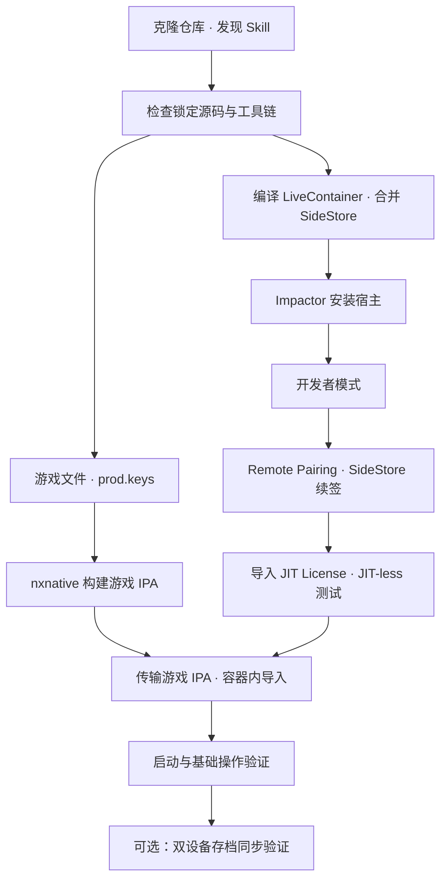

# 端到端流程与验收

本流程面向首次复现和断点续接。游戏侧产物与宿主侧产物是两个 IPA，可独立准备；两边就绪后才在设备上汇合。

## 开始前

确认当前机器、目标设备、游戏版本、已有宿主、工具与输入文件。已有可用宿主、配对或游戏 IPA 时复用并核验，不重复执行整条链。

本次基线为 Apple Silicon Mac、Xcode 27.2、Cuphead 1.3.7、iPad mini A17 Pro。硬件/系统要求以所检出 nxnative 的 README 和具体 IPA 的 Info.plist 为准，不把此案例推广为任意 Switch 游戏、任意旧设备都适用。

## 按阶段执行

| 阶段 | 调用 | 完成标准 | 责任与边界 |
|---|---|---|---|
| 1 仓库与工具 | `$nxnative-workflow 初始化环境` | Skill 发现入口可读；源码提交明确；工具实测结果明确 | 可自动检查/按已有授权补齐；初始化本身仅检查工具缺项 |
| 2 本地输入 | `$nxnative-workflow 准备游戏与密钥` | 游戏/更新/DLC/密钥路径和版本明确 | 可选资源网站入口；不要求重新下载已有文件 |
| 3 游戏构建 | `$nxnative-workflow 编译游戏` | 流水线退出 0，IPA/日志/校验记录存在 | 只承诺构建，不把它等同于真机运行 |
| 4 宿主构建 | `$nxnative-workflow 编译LiveContainer` | BUILD SUCCEEDED；合并脚本通过并生成报告 | 已有匹配的宿主产物可复用；不自行升级 SideStore |
| 5 宿主安装 | `$nxnative-workflow 准备LiveContainer安装` | Impactor 交接完成，用户确认实际安装 | 账号、设备、原 bundle ID、Only Register Main Bundle |
| 6 开发者模式 | `$nxnative-workflow 配置SideStore续签` | 设备开启并在重启后确认 | iPad/iPhone 用户界面确认 |
| 7 配对与续签 | 同上 | Remote Pairing Validate；Active/Preferred=rppairing；Refresh All 成功 | 同一台设备、idevice 后端、LocalDevVPN |
| 8 JIT-less | `$nxnative-workflow 配置JIT-less` | 证书导入且 Test JIT-Less Mode 通过 | 首次运行前单独核验；用户称该证书为 JIT License |
| 9 游戏导入 | `$nxnative-workflow 安装游戏到LiveContainer` | IPA 到正确 Documents；导入后应用元数据和安装时间存在 | 可按用户已有授权传输并调用容器导入；不覆盖已有游戏 |
| 10 基础运行 | `$nxnative-workflow 验证运行` | 实际看到标题/场景，输入、声音和保存/退出/重启结果明确 | 设备反馈或实际观察；安装记录不能替代 |
| 11 可选同步 | `$nxnative-workflow 配置存档同步` | 双设备 A→B、B→A、冲突/恢复按场景验证 | 只同步游戏已提交存档；不是配对文件续签 |

阶段参考：[游戏构建](game-build.md)、[宿主构建](livecontainer-build.md)、[安装交接](livecontainer-install.md)、[续签与证书](sidestore-setup.md)、[设备导入](game-install.md)、[可选存档同步](save-sync.md)。

## 运行验收

首次运行建议按以下顺序记录，任何失败保留日志并停在该环节排查：

1. LiveContainer JIT-less 测试通过。
2. 游戏出现启动/标题画面，记录是否能进入实际场景。
3. 基本触控或控制器输入有效，声音可听见。
4. 产生一份测试进度，退出并重新打开后仍能读到。
5. 需要同步时，用两台设备和同一游戏版本另做双向存档往返。

不在未经观察时填“全部通过”。当前用户已确认整体安装启动流程跑通；详细长时间运行和双设备 iCloud 同步不扩大为已测试结论，参见 [验证基线](validated-baseline.md)。

## 常见停止点

| 现象 | 先检查 |
|---|---|
| Skill 选择器没有项目 Skill | `.agents/skills` 链接、界面显示名、是否进入正确项目；必要时重启客户端 |
| `dotnet` 不存在或 publish 失败 | 当前环境与 SDK；仅有 CLion 的 runtime 不等于有 SDK |
| 找到 metal 路径但不能运行 | `xcrun -sdk iphoneos metal --version` 的实际结果；可能只有 shim |
| 子模块 HEAD 正确却缺头文件 | 工作区源码是否真的检出；不据此删除用户修改 |
| 网页 200 却无密钥 ZIP | 下载页内容/正常口令表单；实际文件格式；不能将 HTML 当作 ZIP |
| iOS 26 启动要求 JITLess | LiveContainer 中导入 JIT License/签名证书，再做 JIT-less 测试 |
| 文件复制成功但游戏未出现 | 当前宿主 bundle ID、Documents 路径、导入请求及安装完成标记 |
| 续签失败 | 配对类型、同设备 Validate、Active/Preferred、idevice、VPN 和原始错误 |

## 发布给其他人之前

本机案例可复现与远程 clone 可复现需要分别核对：

- 基础仓需要真实提交，且发现链接与 Skill 文件都被提交。
- LiveContainer 的 Save Sync 修改、Package.swift、Tests、docs 和打包脚本需要先在子仓形成可取得的提交；基础仓再锁定该提交。只提交旧 gitlink 不会携带本机修改。
- 不发布 `games/`、配对/密钥/证书、本地下载或构建产物。基础合并 IPA 要作为使用者本地输入，打包脚本校验其版本和哈希。
- 以新的普通 clone 测试 Skill 发现，再以 submodule 初始化确认两份源码和对应功能存在。
- 真实录屏与发布说明使用已经发布的版本；没有发布时明确是本地验证版。

本次文档固化不自动提交子仓、更新指针或推送远程。
